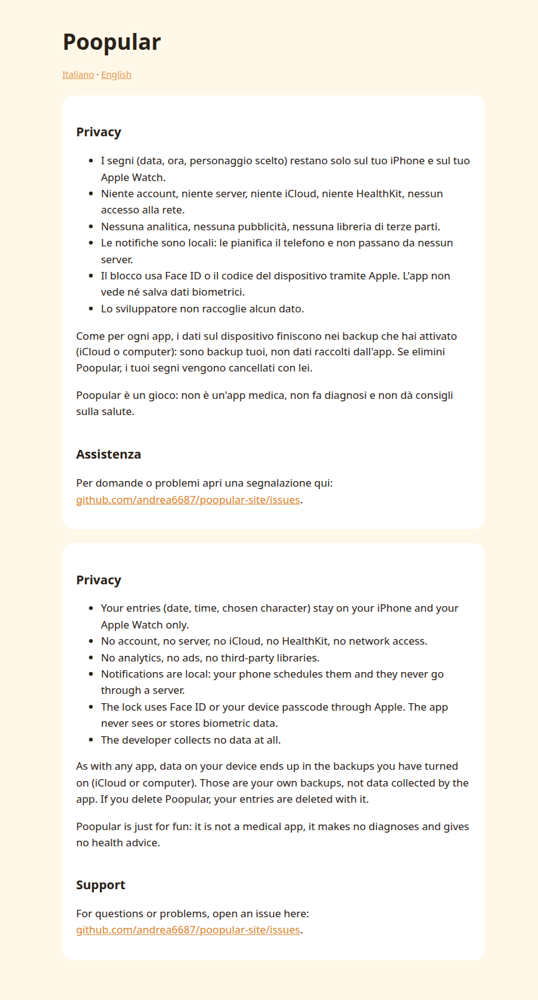

# Poopular

🇬🇧 [English version](README.md)

**Pagina di privacy e assistenza di Poopular, un gioco per iPhone e Apple Watch.**



Questo repository è quella pagina. Dice cosa resta sul tuo iPhone e sul tuo Apple Watch, cosa l'app non raccoglie e dove chiedere aiuto. La pagina è un solo file HTML, pubblicato con GitHub Pages. Dietro non c'è un server.

👉 **La pagina:** https://andrea6687.github.io/poopular-site/

## Leggila

[Italiano](https://andrea6687.github.io/poopular-site/#it) e [inglese](https://andrea6687.github.io/poopular-site/#en) stanno sulla stessa pagina.

Sul computer apri [`index.html`](index.html) in un browser. Non c'è niente da installare e niente da compilare.

## Cosa dice la pagina

- I segni (data, ora, personaggio scelto) restano solo sul tuo iPhone e sul tuo Apple Watch.
- Niente account, niente server, niente iCloud, niente HealthKit, nessun accesso alla rete.
- Nessuna analitica, nessuna pubblicità, nessuna libreria di terze parti.
- Le notifiche sono locali: le pianifica il telefono e non passano da nessun server.
- Il blocco usa Face ID o il codice del dispositivo tramite Apple. L'app non vede né salva dati biometrici.
- Lo sviluppatore non raccoglie alcun dato.

Come per ogni app, i dati sul dispositivo finiscono nei backup che hai attivato (iCloud o computer): sono backup tuoi, non dati raccolti dall'app. Se elimini Poopular, i tuoi segni vengono cancellati con lei.

Poopular è un gioco: non è un'app medica, non fa diagnosi e non dà consigli sulla salute.

## Assistenza

Per domande o problemi apri una [issue](https://github.com/andrea6687/poopular-site/issues).

## File

```
index.html    la pagina: italiano (#it) e inglese (#en), pubblicata su GitHub Pages dalla radice di main
```

L'app non è in questo repository. Per contribuire leggi [CONTRIBUTING.md](CONTRIBUTING.md).

## Licenza

[MIT](LICENSE) © Andrea Sportello

---

Se la pagina ti è stata utile, una ⭐ al repository aiuta altre persone a trovarlo. Problemi e idee sono benvenuti nelle [issue](https://github.com/andrea6687/poopular-site/issues).
