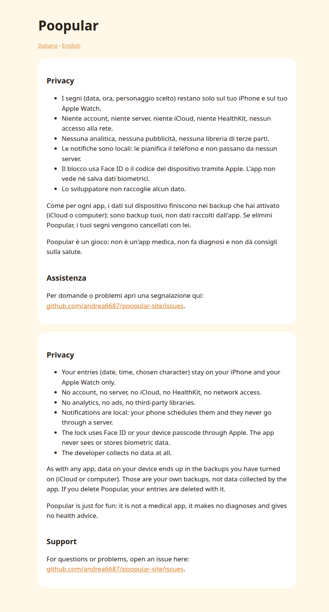

# Poopular

🇮🇹 [Versione italiana](README.it.md)

**Privacy and support page for Poopular, a game for iPhone and Apple Watch.**



This repository is that page. It says what stays on your iPhone and your Apple Watch, what the app does not collect, and where to ask for help. The page is one HTML file, published with GitHub Pages. There is no server behind it.

👉 **The page:** https://andrea6687.github.io/poopular-site/

## Read it

[Italian](https://andrea6687.github.io/poopular-site/#it) and [English](https://andrea6687.github.io/poopular-site/#en) are on the same page.

On your computer, open [`index.html`](index.html) in a browser. Nothing to install, and nothing to build.

## What the page says

- Your entries (date, time, chosen character) stay on your iPhone and your Apple Watch only.
- No account, no server, no iCloud, no HealthKit, no network access.
- No analytics, no ads, no third-party libraries.
- Notifications are local: your phone schedules them and they never go through a server.
- The lock uses Face ID or your device passcode through Apple. The app never sees or stores biometric data.
- The developer collects no data at all.

As with any app, data on your device ends up in the backups you have turned on (iCloud or computer). Those are your own backups, not data collected by the app. If you delete Poopular, your entries are deleted with it.

Poopular is just for fun: it is not a medical app, it makes no diagnoses and gives no health advice.

## Support

For questions or problems, open an [issue](https://github.com/andrea6687/poopular-site/issues).

## Files

```
index.html    the page: Italian (#it) and English (#en), published on GitHub Pages from the root of main
```

The app itself is not in this repository. To contribute, read [CONTRIBUTING.md](CONTRIBUTING.md).

## License

[MIT](LICENSE) © Andrea Sportello

---

If the page was useful, a ⭐ on the repository helps other people find it. Bugs and ideas are welcome in the [issues](https://github.com/andrea6687/poopular-site/issues).
